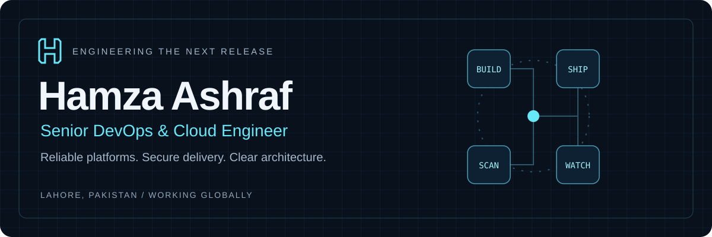
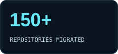
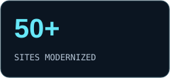

  

  <a href="https://hamza-ashraf.vercel.app"><strong>Explore my portfolio ↗</strong></a> &nbsp; · &nbsp;
  <a href="https://hamza-ashraf.vercel.app/news">Live Security Radar</a> &nbsp; · &nbsp;
  <a href="https://hamza-ashraf.vercel.app/Hamza-Ashraf-DevOps-Resume.pdf">Résumé PDF</a> &nbsp; · &nbsp;
  <a href="https://www.linkedin.com/in/hamzaashraf020/">LinkedIn</a>

### I build the systems behind dependable software.

I'm **Hamza**, a Senior DevOps & Cloud Engineer based in **Lahore, Pakistan**, working with distributed teams. I turn complex cloud and on-premises environments into platforms that teams can deploy, observe, secure, and operate with confidence.

My work spans **AWS and Azure**, **Kubernetes and Docker**, **Terraform**, **CI/CD**, **observability**, and **private AI infrastructure**. I care about practical architecture, understandable runbooks, repeatable releases, and a tested way back when something fails.

  
  
  
  

## Selected engineering work

These are professional case studies from my [portfolio](https://hamza-ashraf.vercel.app/#projects). Expand a project for implementation details; the linked site contains its architecture diagram. Public code examples are listed separately below.

<strong>01 / AI Voice Bot &amp; Landline Integration</strong>

**Azure Communication Services · Microsoft Teams Phone · Event Grid**

Engineered an enterprise voice integration that connects public landline callers to a conversational AI bot through Microsoft Teams resource accounts, Azure Communication Services and an event-driven backend.

- Provisioned Teams resource accounts with the required licensing and assigned phone numbers for inbound PSTN calls.
- Linked the Teams resource account to an ACS resource through backend provisioning scripts and configured the required Microsoft Graph permissions and access assignments.
- Configured Azure Event Grid to deliver incoming-call notifications to a secure HTTPS webhook endpoint.

**Stack:** Azure Communication Services · Microsoft Teams Phone · Azure Event Grid · Microsoft Graph · Call Automation · HTTPS Webhooks · WebSocket Audio · Conversational AI

[View architecture & full case study ↗](https://hamza-ashraf.vercel.app/#project-ai-voice-bot-landline-azure)

<strong>02 / Hybrid Monorepo CI/CD &amp; Docker Compose</strong>

**On-premises GitLab · TeamCity · 12-service legacy platform**

Architected a grouped multi-repository delivery strategy on a private GitLab server, retaining TeamCity for enterprise and legacy builds while giving the client explicit control over on-premises Docker Compose releases.

- Compiled shared libraries and published packages to the on-premises GitLab Package Registry.
- Integrated TeamCity with GitLab application groups to test and build backend, frontend, and legacy platform code; published artifacts and versioned container images to GitLab.
- Coordinated Monolith backend, Monolith web, Mailer, Ignite, Pimco, Pimco worker, Dacon, Simon, Pepperlog, OpenSearch, and OpenSearch Dashboards.

**Stack:** GitLab CI/CD · TeamCity · Docker Compose · GitLab Package Registry · GitLab Container Registry · OpenSearch · On-premises

[View architecture & full case study ↗](https://hamza-ashraf.vercel.app/#project-hybrid-teamcity-compose)

<strong>03 / 150+ Repositories GitLab Enterprise Migration</strong>

**On-Premise Enterprise Codebase & CI/CD Infrastructure**

Spearheaded the complete migration of over 150 code repositories from GitHub to an on-premise self-hosted GitLab instance with distributed runners across 54 Ubuntu servers.

- Architected 30+ concurrent GitLab runners across 54 dedicated Ubuntu nodes.
- Integrated HashiCorp Vault to provide zero-trust dynamic secrets management within CI/CD pipelines.
- Implemented strict staging, release, and production pipeline stages with automated rollbacks.

**Stack:** GitLab CI/CD · HashiCorp Vault · Ubuntu Server · Nexus · Docker · Bash

[View architecture & full case study ↗](https://hamza-ashraf.vercel.app/#project-gitlab-enterprise-migration)

<strong>04 / Multi-Node CapRover Cluster &amp; 50+ Site Migration</strong>

**High-Availability Containerized Web Platform**

Replaced legacy shared hosting and cPanel environments by deploying a multi-node CapRover cluster, migrating 50+ WordPress and PHP applications encompassing 50GB+ of production data.

- Engineered clustered volume management and automated SSL certificate renewals via Let's Encrypt.
- Configured Traefik / Nginx reverse proxy with load balancing and DDoS throttling.
- Implemented automated database snapshotting and off-site backup schedules.

**Stack:** CapRover · Docker Swarm · Nginx · MySQL · PHP · Ubuntu · Let's Encrypt

[View architecture & full case study ↗](https://hamza-ashraf.vercel.app/#project-caprover-cluster-modernization)

<strong>05 / Full-Stack Distributed Tracing &amp; Observability</strong>

**Real-Time APM & Infrastructure Health Monitoring**

Engineered an end-to-end observability stack integrating SigNoz with OpenTelemetry for distributed microservices tracing, complemented by Zabbix for server telemetry.

- Instrumented Java, Node.js, and Python microservices with OpenTelemetry agents.
- Deployed SigNoz on Kubernetes/Docker for distributed tracing and bottleneck discovery.
- Configured Zabbix triggers and threshold alerts integrated into MS Teams webhook channels.

**Stack:** SigNoz · OpenTelemetry · Zabbix · Prometheus · Grafana · MS Teams API

[View architecture & full case study ↗](https://hamza-ashraf.vercel.app/#project-distributed-observability-signoz)

<strong>06 / Private GPU-Accelerated MLOps Platform</strong>

**Secure On-Premise LLM Serving & MinIO Object Storage**

Provisioned an on-premise AI engineering environment featuring Ollama on GPU-enabled Windows/Linux servers paired with MinIO object storage for secure model weights and dataset isolation.

- Configured Ollama for localized serving of Llama and deep learning inference models.
- Deployed MinIO S3-compatible storage cluster to substitute for public cloud S3 buckets.
- Enforced IP whitelisting, firewall perimeter isolation, and access control policies.

**Stack:** Ollama · MinIO (S3) · Windows Server · Linux · Docker · Model Context Protocol · GPU Acceleration

[View architecture & full case study ↗](https://hamza-ashraf.vercel.app/#project-gpu-mlops-private-infrastructure)

<strong>07 / AWS ECS Zero-Downtime Blue/Green Deployment</strong>

**Cloud-Native Container Delivery Architecture**

Architected a fully automated CI/CD pipeline using AWS CodePipeline, ECR, and ECS with Application Load Balancer traffic shifting for zero-downtime releases.

- Configured AWS CodePipeline pulling from GitHub and building container images via CodeBuild.
- Pushed versioned Docker tags to Amazon Elastic Container Registry (ECR).
- Configured Amazon ECS task definitions with blue/green deployment strategy via ALB.

**Stack:** AWS ECS · AWS ECR · AWS CodePipeline · Application Load Balancer · Docker · CloudWatch

[View architecture & full case study ↗](https://hamza-ashraf.vercel.app/#project-aws-ecs-blue-green-pipeline)

<strong>08 / Zero-Downtime PostgreSQL Cloud Migration</strong>

**Heroku to AWS RDS Infrastructure Modernization**

Executed a comprehensive database migration moving critical production PostgreSQL instances from Heroku to AWS RDS, slashing recurring operational costs.

- Executed schema validation and optimized database indexing prior to migration.
- Automated dump and restore sequences using pg_dump and parallel restoration streams.
- Configured AWS VPC security groups, subnets, and automated read replicas.

**Stack:** AWS RDS · PostgreSQL · Heroku CLI · VPC Networking · Bash

[View architecture & full case study ↗](https://hamza-ashraf.vercel.app/#project-cloud-database-migration-heroku-aws)

<strong>09 / DevSecOps Vulnerability Scanning &amp; Secure Supply Chain</strong>

**Automated Container & Code Security Auditing**

Integrated automated security gates into production delivery pipelines to identify CVEs, container vulnerabilities, and misconfigurations prior to staging promotion.

- Integrated Trivy scanner to analyze container images for known vulnerabilities during build.
- Configured SonarQube quality gates to enforce static application security testing (SAST).
- Set up Nexus Repository Manager as a secure proxy to eliminate upstream dependency tampering.

**Stack:** Trivy · SonarQube · Nexus · GitLab CI · Docker · Bash

[View architecture & full case study ↗](https://hamza-ashraf.vercel.app/#project-devsecops-pipeline-trivy)

<strong>10 / Enterprise Hybrid Learning Management Platform</strong>

**Azure Active Directory SSO & Multi-Cloud Services**

Designed a secure hybrid cloud infrastructure running across Microsoft Azure and AWS to power an enterprise LMS with centralized identity management.

- Integrated Azure Active Directory for single sign-on (SSO) and role-based access control.
- Deployed front-end services on Windows Server instances and back-end microservices on Ubuntu Linux.
- Configured separate isolated environments for staging and production tiers.

**Stack:** Microsoft Azure · Azure AD · AWS · PostgreSQL · Windows Server · Ubuntu · Nginx

[View architecture & full case study ↗](https://hamza-ashraf.vercel.app/#project-hybrid-cloud-lms-azure-aws)

## Public repositories

Practical infrastructure examples and operational tooling you can inspect:

| Repository | What you will find |
| --- | --- |
| [Linux security audit, fix & rollback](https://github.com/hamzaatservice/server-security-scan) | Bash tooling for Linux security audits, remediation, and rollback workflows. |
| [Server Resource Analyzer](https://github.com/hamzaatservice/python-server-analyzer) | Python diagnostics for storage, CPU, memory, processes, and server health reports. |
| [KnowledgeCity Terraform](https://github.com/hamzaatservice/knowledgecity-terraform) | Modular Terraform infrastructure provisioning for AWS. |
| [GitLab CI/CD for ECS](https://github.com/hamzaatservice/GitLab-CI-CD-Pipeline-for-ECS) | Container build and delivery configuration for Amazon ECR and ECS. |
| [GitHub Actions for ECS](https://github.com/hamzaatservice/Github-CI-CD-for-ecs-deployment) | An Actions workflow for building, tagging, and pushing images, then updating ECS. |
| [PostgreSQL replicas & pgvector](https://github.com/hamzaatservice/Psql-read-write-replicas-with-vectorpg) | A reference transactional primary/replica setup, separate vector database, and lifecycle scripts. |

[Browse all public repositories ↗](https://github.com/hamzaatservice?tab=repositories)

## My engineering toolkit

| Discipline | Tools I work with |
| --- | --- |
| **Cloud & platforms** | AWS · Microsoft Azure · Linux · Windows Server |
| **Containers & delivery** | Kubernetes · Docker · Docker Compose · ECS · CapRover |
| **Infrastructure & CI/CD** | Terraform · GitLab CI/CD · GitHub Actions · TeamCity · CodePipeline |
| **Security & supply chain** | HashiCorp Vault · Trivy · SonarQube · Nexus |
| **Observability** | OpenTelemetry · SigNoz · Prometheus · Grafana · Zabbix · OpenSearch |
| **Data & storage** | PostgreSQL · MySQL · Amazon RDS · S3 · MinIO |
| **AI & communications** | Ollama · GPU infrastructure · ACS · Teams Phone · Event Grid |
| **Automation** | Bash · Python · APIs · Webhooks |

## How I work

**Design for operation.** Document the architecture, failure modes, ownership, and recovery path before they become production surprises.

**Automate with guardrails.** Version infrastructure, scan artifacts, protect secrets, and make deployment approvals explicit when the environment requires them.

**Make production observable.** Connect traces, logs, metrics, health checks, and actionable alerts so teams can diagnose issues quickly.

**Collaborate across time zones.** Clear written updates, shared runbooks, and planned overlap with global engineering teams.

## Let's build something dependable

I'm open to **Senior DevOps, Cloud, and Platform Engineering roles**, as well as conversations about infrastructure modernization and delivery automation.

**[Portfolio](https://hamza-ashraf.vercel.app)** · **[LinkedIn](https://www.linkedin.com/in/hamzaashraf020/)** · **[Email](mailto:hamzaashraf020@live.com)**

Cloud engineering. Human perspective.
